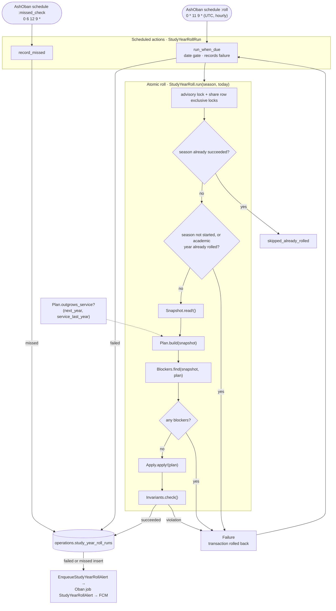

# Annual study-year roll (ENG-202)

Advances every graded person one study year on 11 September (Nayrouz), and
moves the service memberships, group memberships, classes and servant scopes
that depend on their grade. On the Ash server the roll is Elixir code
(`ChurchAdmin.Operations.StudyYearRoll`), scheduled by AshOban, and every
outcome is a row in `operations.study_year_roll_runs`.

`master` still runs the Hasura-era implementation: `pg_cron` jobs calling
plpgsql procedures, and a Hasura event trigger with the
`notifyStudyYearRollFailure` Cloud Function for the failure alert. This
document describes the Ash backend (ENG-266), an experimental alternative
backend; there is no decision to merge it to `master`.

## Pipeline

The one domain rule shared by memberships, classes and scopes is
`Plan.outgrows_service?/2`: a cohort whose next study year is past a
bounded service's last year (or that has no next year at all) leaves that
service. Everything else is bookkeeping around it.

## Scheduling

The schedules are AshOban scheduled actions on `StudyYearRollRun`, run by Oban
on the `study_year_roll` queue (concurrency 1) of the Ash server. Nothing needs
enabling in Postgres: the migration `move_study_year_roll_to_ash_oban`
unschedules the two `pg_cron` jobs of the Hasura-era implementation and drops
its plpgsql routines.

The roll is scheduled as `0 * 11 9 *` — hourly for the whole of 11 September,
**UTC**. Oban evaluates cron expressions in UTC, so a literal `0 0 11 9 *` would
not mean midnight in Cairo, and would drift whenever Egypt changes its DST
rules. Instead the schedule is deliberately loose and `run_when_due` decides
whether to act, comparing today's Cairo date (`now() at time zone
'Africa/Cairo'`) against 11 September of that year:

- Not 11 September Cairo: does nothing.
- 11 September Cairo: runs, unless this season already succeeded.
- 12 September 06:00 UTC: `record_missed` writes `missed` if no `succeeded` or
  `missed` run was recorded for the season, per [C14].

Hourly firing gives free retries within the day when the midnight attempt fails,
which is the retry policy [E19] left open. It never produces an unattended
catch-up on a later date.

Both actions take an optional `today` date that defaults to the Cairo date. It
exists so the tests can drive the date gate and the failure path; the schedules
call them without it.

## Transaction and failure recording

The roll must be atomic, but a rolled-back transaction cannot leave a record of
its own failure. The two are separated:

- `StudyYearRoll.run/2` is the atomic unit. All writes happen here, as bulk
  actions of the system actor inside the caller's transaction. A failure
  (refusal, blockers, an invariant violation or an exception from a bulk
  action) is returned as a `Failure` and the caller rolls the transaction back.
- `run_when_due` and the operator's `run` action (`run_recording_refusal/2`)
  wrap it in `Repo.transaction`. When the roll fails, `record_failure` records
  `failed` with the error message and detail (the blocker list lives in
  `detail`) in a transaction of its own, after the roll has been rolled back.

After applying the plan, and inside the roll's transaction, `Invariants.check`
verifies what the deferred database triggers `persons_container_check` and
`check_persons_service_rel` verify on the roll's own writes: every person the
roll updated keeps a family, store, uid, service or group, and every
membership it inserted fits the service's study year range. A violation rolls
the whole roll back. Violations elsewhere never fail the roll. A failed range
check's detail lists every violating membership (`person_id: … service_id: …`,
one per line), where the trigger stopped at the first.

Idempotency is a partial unique index on `season_year where status = 'succeeded'`.
A failed attempt therefore does not block a retry the same day, and a successful
one can never be repeated ([C13], [C16]).

A second partial unique index on `season_year where status = 'failed'` keeps the
hourly retries to one `failed` row per season: `record_failure` takes an
advisory lock per season, then creates the `failed` row or, when one exists,
updates it (`replace_failed_run_error`) with the latest attempt's error and
time. Retries stay free, but a season that fails all day alerts once rather
than twenty-one times.

The `create_failed_run` and `create_missed_run` actions enqueue an Oban job,
`StudyYearRollAlert`, in the same transaction as the row, so the alert exists
exactly when the run does. The job sends an FCM maintenance notification to the
device tokens of users holding the `maintenanceNotifications` permission, with
the text the Cloud Function sent on `master`. Tokens FCM reports unregistered
are deleted. A delivery failure fails the job and Oban retries it (5 attempts);
the run's `notified_at` is set only after every token was tried without a
failure. The update that replaces a failed run's error does not enqueue a job,
which is what bounds the alert to one per season.

## Concurrency

The roll takes `pg_advisory_xact_lock` so two rolls cannot interleave, and locks
`study_years`, `services`, `persons`, `persons_services`, `persons_groups`,
`classes` and `auth.users_admin_on` in `share row exclusive` mode for its
duration. Reads are unaffected; concurrent writers wait for the few seconds the
roll takes. This closes [E18], which the advisory lock alone did not.

## Pre-flight validation

`Blockers.find/2` checks the `Snapshot` and `Plan` and returns one entry
(`issue_code`, `detail`) per blocking problem. The roll calls it before
applying anything and aborts without mutating. It is also meant to be run
manually in early September, through the `blockers` action of `StudyYearRollRun`
(system actor only), so that a misconfiguration surfaces days ahead instead of aborting the unattended run at
midnight with no catch-up available.

It blocks on:

- a `next_service_id` cycle or self-link ([E7])
- a person whose only remaining connection would be removed ([C8])
- a class whose destination placement would not match its cohort's next grade ([C9], [E8])
- a `next_service_id` pointing at a soft-deleted service, when a membership or
  class would actually move there ([E14])
- a person whose next grade falls outside the destination service's study year
  range, which the deferred `check_persons_service_rel` would otherwise raise
  after the plan was applied, long after the pre-flight passed

The first, third and fourth are invariants on `services` that could be enforced
by a trigger at write time instead; that is a schema change outside this
ticket, and the pre-flight would stay regardless because its job is a readable
report days ahead, not enforcement.

## Decisions taken on items the ticket left open

**Servant scope wrap ([E11]).** When the wrap target would be `null` — the
service has no lower bound, so `null` means all-year access — the scope is left
unchanged and counted as skipped. The roll never widens a servant's access.

**Converging memberships.** `persons_services` is unique on
`(person_id, service_id)`. When two of a person's memberships route to the same
next service, or the person already holds the destination, all but one row are
deleted (`dedupe`) before the survivor moves. Without that step the move would
raise a unique violation and abort the whole roll.

**Group memberships (§2b).** Nothing re-checks a group membership when a
service membership changes (on `master` the `persons_groups_check` trigger ran
only when the group membership itself was written), so dropping or moving a
service membership can strand a group membership whose service the person has
left. After the service step, group memberships whose group belongs to a
service the person is leaving, and which no other membership brings them back
into, are deleted and counted.
Group memberships are not auto-moved to the destination service: there is no
reliable mapping between a source group and a destination one.

**Soft-deleted classes ([E14]).** Skipped. A deleted class has no live roster to
carry forward and advancing a tombstone only corrupts it. Soft-deleted _people_
still advance, per [C3].

**Classes stay cohorts ([C9], [C10]).** A class is a (service, grade) cohort.
Each roll the cohort's grade goes up: `advance` bumps `service_study_year`
within the same service; `relocate` moves the class to `next_service_id` at
that service's first grade when the cohort outgrows the service; `delete` sets
`deleted_at` when the next service is ungraded, because an all-ages service has
no grade slot for the cohort to land in. A cohort that outgrows a service with
no next service, or that has no next grade, is left alone. The alternative — classes as fixed slots that never move, with
membership resolved live from service, grade and gender — would delete [C9],
[C10], [E8], [E13] and [E15] outright. It was raised and not adopted; revisit
before adding more class-move complexity.

## Recovery

Counts alone cannot reconstruct changed rows ([E23]). Rolling back the
`move_study_year_roll_to_ash_oban` migration recreates the Hasura-era functions
from `priv/repo/sql/recreate_study_year_roll.sql`; it does not and cannot undo a
roll. Re-running the roll is never an undo. Recovery from a bad-but-committed roll is a restore from
the point-in-time backup taken before the scheduled window.

## Manual and late runs

A late or repeat run is deliberately awkward. The `run` action of
`StudyYearRollRun` (system actor only; `run_study_year_roll(season)` on
`master`) can be called directly, but only after confirming no manual
advancement happened in the meantime ([E2]).

The roll itself refuses to advance twice in one academic year.
The academic year starts on 1 September (Cairo), so an operator may roll early
in September for the coming season: a run dated before it belongs to the
previous year's, and a season counts as the academic year it starts. Two
refusals follow. A season that starts after the run date's academic year is too
early (season 2027 in October 2026). A season other than one already rolled is
refused when a `succeeded` run exists for a season at or after the run date's
academic year. Nothing is applied; `failed` is recorded for the requested
season with the reason, so the usual alert fires. A repeat of a season that
already succeeded stays `skipped_already_rolled`. There is no override. The
rule reads only `season_year`, so every row recorded before it keeps its
meaning.

Production was rolled for season 2026 by the Hasura-era system before the Ash
server's first run. A migration records that as a `succeeded` run for 2026
with `step_counts = {"rolled_by_previous_system": 1}`, only when no run row for
2026 exists, so the scheduled roll of 2026 skips and 2027 rolls from
1 September 2027. The guard treats the row like any other `succeeded` run.
